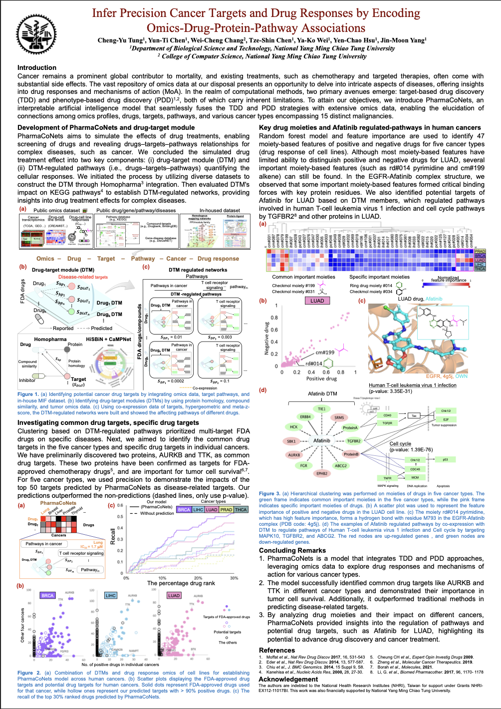

# PharmaCoNets

Pipeline code behind **"Infer Precision Cancer Targets and Drug Responses by Encoding Omics-Drug-Protein-Pathway Associations"**, presented at the 2023 MOPM Conference.

Yun-Ti Chen, **Cheng-Yu Tung**, Wei-Cheng Chang, Tze-Shin Chen, Ya-Ko Wei, Yen-Chao Hsu, Jin-Moon Yang
Department of Biological Science and Technology · College of Computer Science, National Yang Ming Chiao Tung University

[](https://drive.google.com/file/d/16db70f9Q9S6SemEXOBNTJtjBBycy5DOF/view?usp=drive_link)

*Click the poster for the full-size PDF.*

## About

Computational drug discovery usually follows one of two routes — target-based (TDD) or phenotype-based (PDD) — and each has its own limitations. PharmaCoNets is an interpretable model that combines both with large-scale omics data, linking omics profiles, drugs, targets, pathways and 15 cancer types.

The model scores **drug-target modules (DTMs)** and the pathways they regulate. Across the cancer types examined, AURKB and TTK came out as consensus targets in 80% of them, alongside targets specific to individual cancers.

## What is in this repository

The scripts that build the drug-target modules: starting from a list of differentially expressed genes for a cancer type, they gather the associated compound records, compute compound-similarity and protein-homology evidence, and merge the results into one table per cancer type.

`Pharmaconets.py` is the driver and runs the steps in order. Each script carries a header comment with its aim, usage, inputs and outputs.

| Step | Script | Role |
|---|---|---|
| ID mapping | `Pharmaconet_UniProt_IDmapping.py` | Maps the input gene list to UniProtKB through the UniProt REST API |
| PCN0 | `PCN0_Get_DEG_inhibitors_from_BindingDB.php` | Collects the matching BindingDB records and splits them by an affinity cutoff |
| PCN1 | `PCN1_Get_BDBM_cm_ac_features.php` | Computes Checkmol functional-group and atom-composition features |
| PCN2 | `PCN2_General_tanimoto_single_db.php` | Generalized Tanimoto similarity against DrugBank approved compounds |
| PCN3 | `PCN3_Select_similar_inhibitor_of_drug_with_cutoff.php` | Keeps pairs above the similarity cutoff |
| PCN1–3 | `PCN1_2_3.py` | Python implementation of PCN1–PCN3 (the one the driver calls) |
| PCN4 | `PCN4_Filter_heavy_atom_number.php` | Heavy-atom count filter |
| PCN5 | `PCN5_Mapping_targets_from_BindingDB_record.php` | Attaches target and affinity values to each pair |
| PCN6 | BLASTP → `PCN6_1_Prcoess_blast_output.php` | Protein homology search and filtering of the hits |
| PCN7 | `PCN7_prepare_homologous_and_DEGs_uniprot_uids_list.py` → `PCN7_Merge_to_community.php` | Merges all evidence into the final community table |

## Running it

```sh
python3 Pharmaconets.py <run_name>
```

Logs are written to `./log/`, intermediate files to `./input/` and `./output/`.

**Note:** the scripts expect reference databases (BindingDB, DrugBank, Checkmol, BLAST+) at absolute lab-server paths, and those paths are hard-coded near the top of each script. They need editing before the pipeline will run elsewhere. The reference databases are not redistributed here — obtain them under their own licences.

## Requirements

PHP · Python 3 (`pandas`, `requests`) · NCBI BLAST+ · Checkmol
